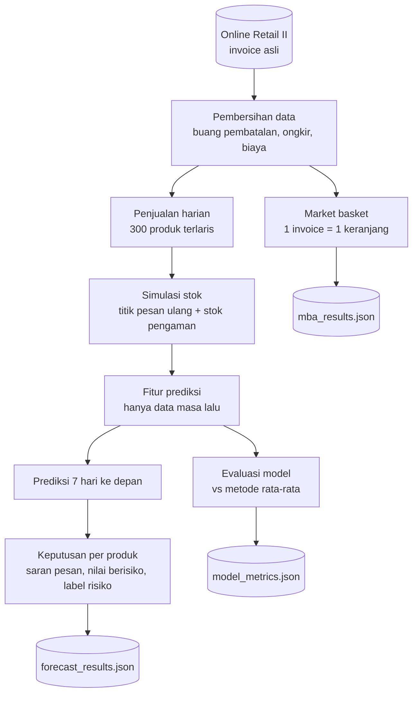
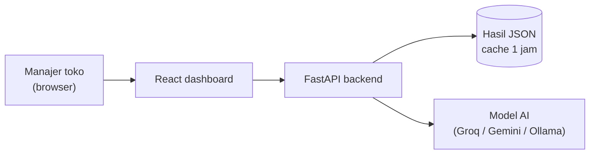
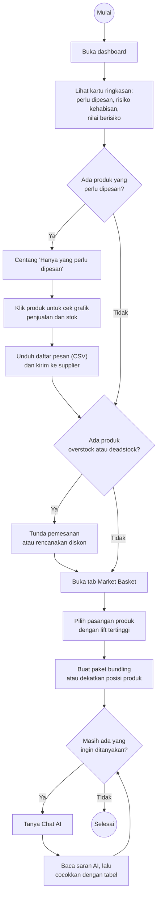
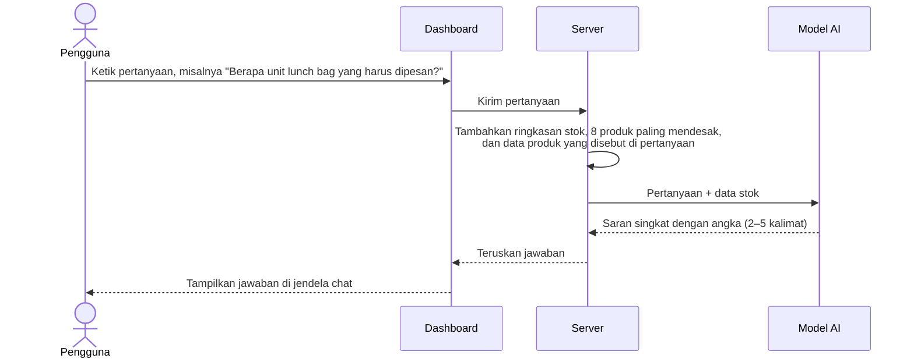
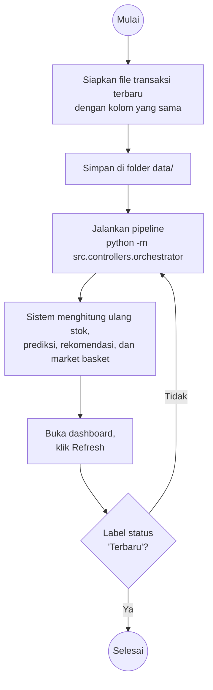

# Retail Inventory AI

Sistem analitik berbasis AI untuk membantu toko ritel mengelola stok. Sistem ini menjawab empat pertanyaan yang sering dihadapi manajer toko:

| Pertanyaan manajer | Cara sistem menjawab |
|---|---|
| Berapa banyak setiap produk akan terjual minggu depan? | **Prediksi permintaan 7 hari** dengan model gradient boosting |
| Produk mana yang harus dipesan hari ini, dan berapa unit? | **Rekomendasi pesan** dari prediksi, stok, dan waktu kirim supplier |
| Produk apa yang sering dibeli bersamaan? | **Market basket analysis** dari invoice asli |
| "Kenapa produk ini berisiko?" | **Chat AI** yang membaca kondisi stok terbaru |

Tujuannya: mencegah **kehabisan stok (stockout)** yang membuat penjualan hilang, dan mengurangi **stok berlebih (overstock)** yang menahan modal.

> Dikembangkan ulang dari proyek kelompok mata kuliah AI for Business, Institut Teknologi Bandung (2026). Lihat [Asal Proyek](#-asal-proyek).

---

## 📊 Dataset

Proyek ini memakai **[Online Retail II](https://archive.ics.uci.edu/dataset/502/online+retail+ii)** dari UCI Machine Learning Repository (lisensi **CC BY 4.0**).

- Transaksi asli sebuah toko online di Inggris yang menjual barang hadiah dan perlengkapan rumah, periode **1 Desember 2009 – 9 Desember 2011**.
- Sekitar **1,07 juta baris**. Kolom: `Invoice`, `StockCode`, `Description`, `Quantity`, `InvoiceDate`, `Price`, `Customer ID`, `Country`.
- Banyak pelanggannya adalah pedagang grosir, jadi sesekali ada pesanan dalam jumlah sangat besar.

**Kenapa dataset ini:**
1. Ada **jumlah unit** dan **harga**, sehingga prediksi bisa dinyatakan dalam unit sekaligus nilai uang (£).
2. Ada **nomor invoice**, sehingga market basket memakai keranjang belanja yang sesungguhnya.
3. Lisensinya terbuka, sehingga hasilnya boleh dipublikasikan.

Sitasi: Chen, D. (2012). *Online Retail II* [Dataset]. UCI Machine Learning Repository. https://doi.org/10.24432/C5CG6D

---

## 🧱 Teknologi

| Lapisan | Teknologi |
|---|---|
| Frontend | React 18, TypeScript, Vite, Recharts |
| Backend | FastAPI, Uvicorn |
| Prediksi permintaan | XGBoost (otomatis memakai gradient boosting scikit-learn jika XGBoost tidak terpasang) |
| Market basket | Aturan asosiasi dua produk (support, confidence, lift) dengan matriks sparse SciPy |
| Chat AI | API apa pun yang kompatibel dengan OpenAI (Groq, Gemini, OpenAI) atau Ollama |
| Data | pandas, NumPy, holidays |
| Kualitas | pytest, GitHub Actions |

---

## 🔄 Alur Kerja Sistem

Sistem punya dua alur: **pipeline**, yang mengolah data dan melatih model, dan **runtime**, yang berjalan saat dashboard dipakai.

### 1. Pipeline: dari data mentah ke rekomendasi



| Tahap | Yang dilakukan | Kode |
|---|---|---|
| **Pembersihan** | Membuang invoice pembatalan (diawali `C`), jumlah atau harga ≤ 0, dan kode non-produk seperti ongkos kirim (`POST`), biaya bank, dan penyesuaian manual. Setiap produk diberi satu nama baku. | `src/data_pipeline/loader.py` |
| **Penjualan harian** | Menghitung unit terjual per hari untuk **300 produk yang paling sering dipesan**. Hari tanpa penjualan diisi 0. Pesanan grosir yang ekstrem dibatasi di persentil ke-99 supaya tidak merusak model. Kategori produk dibuat dari kata kunci pada nama produk. | `src/data_pipeline/pipeline.py` |
| **Simulasi stok** | Dataset hanya berisi penjualan, jadi stok disimulasikan dengan kebijakan *reorder point* yang lazim dipakai toko (lihat [Simulasi Stok](#-simulasi-stok)). | `src/services/stock_simulation.py` |
| **Fitur** | Rata-rata 7/14/28/56 hari, variasi permintaan, hari sejak penjualan terakhir, tren, harga, bulan, jarak ke Natal, dan hari libur Inggris pada minggu berikutnya. Semua fitur hanya memakai data sampai hari itu. | `src/services/feature_service.py` |
| **Evaluasi** | 8 minggu terakhir disisihkan sebagai data uji. Model dibandingkan dengan dua metode sederhana: "sama seperti 7 hari terakhir" dan "rata-rata 28 hari". | `src/services/ml_service.py` |
| **Prediksi** | Model dilatih ulang dengan semua data, lalu memprediksi **total penjualan 7 hari ke depan** untuk setiap produk. | `src/services/ml_service.py` |
| **Keputusan** | Menghitung stok pengaman, titik pesan ulang, saran jumlah pesan, nilai penjualan yang berisiko hilang, dan label risiko. | `src/services/inventory_service.py` |
| **Market basket** | Mencari pasangan produk yang sering muncul di invoice yang sama. | `src/services/mba_service.py` |

Semua tahap dijalankan berurutan oleh `src/controllers/orchestrator.py`.

### 2. Runtime: saat dashboard dipakai



| Fitur di dashboard | Endpoint API | Yang terjadi |
|---|---|---|
| Tab **Stok & Prediksi** | `GET /api/v1/forecast` | Semua produk beserta prediksi, saran pesan, nilai berisiko, dan label risiko |
| Klik satu produk | `GET /api/v1/products/{id}/history` | Grafik penjualan, stok, dan penjualan yang hilang 90 hari terakhir |
| Kotak akurasi model | `GET /api/v1/forecast` (bagian `metadata.model`) | Ringkasan akurasi; evaluasi lengkap per kategori ada di `GET /api/v1/metrics` |
| Tab **Market Basket** | `GET /api/v1/mba` | Pasangan "beli A → cenderung beli B" |
| Tombol **Hitung ulang** | `POST /api/v1/mba/refresh` | Menghitung ulang market basket |
| **Chat AI** | `POST /api/v1/chat` | Pertanyaan + ringkasan stok + data produk yang disebut di pertanyaan dikirim ke model AI |
| Status server | `GET /api/v1/health` | Apakah data sudah ada, sudah usang, dan apakah Chat AI sudah dikonfigurasi |
| Perbarui prediksi | `POST /api/v1/forecast/refresh` | Melatih ulang model (`?rebuild_data=true` untuk membaca ulang dataset) |

Dokumentasi interaktif tersedia di `http://127.0.0.1:8000/docs` saat backend berjalan.

---

## 📦 Simulasi Stok

Online Retail II tidak punya data stok, jadi stok disimulasikan dengan kebijakan yang bisa dipakai toko sungguhan:

| Parameter | Nilai |
|---|---|
| Waktu kirim supplier | 3, 5, 7, atau 10 hari, tetap per produk |
| Stok pengaman | 1,65 × simpangan baku permintaan harian × √waktu kirim (≈ tingkat layanan 95%) |
| Titik pesan ulang | rata-rata permintaan harian × waktu kirim + stok pengaman |
| Jumlah pesan | cukup untuk waktu kirim + 14 hari + stok pengaman, dikurangi stok dan barang yang sedang dikirim |

Rata-rata dan simpangan baku hanya memakai 28 hari terakhir, jadi simulasi tidak pernah "melihat masa depan". Permintaan yang datang saat stok kosong dicatat sebagai **penjualan hilang**.

**Arti label risiko di dashboard:**

| Label | Kapan muncul | Saran tindakan |
|---|---|---|
| **Stockout** | Stok + barang yang sedang dikirim tidak cukup sampai kiriman berikutnya tiba | Pesan hari ini sesuai kolom *Saran pesan* |
| **Overstock** | Stok cukup untuk lebih dari 60 hari | Tunda pemesanan |
| **Deadstock** | Tidak terjual sama sekali selama 60 hari, tapi masih ada stok | Diskon atau cuci gudang |
| **Promo** | Penjualan turun dan stok masih cukup untuk lebih dari 30 hari | Pertimbangkan promosi |
| **Lost Sales** | Ada permintaan yang tidak terlayani dalam 30 hari terakhir | Tambah stok pengaman |

---

## 🚀 Instalasi

### Prasyarat
- Python 3.10 atau lebih baru
- Node.js 18 atau lebih baru
- (Opsional) API key LLM untuk Chat AI. Groq dan Gemini punya tier gratis.

### Langkah 1: Clone dan install

```bash
git clone https://github.com/rivaldimhr/retail-inventory-ai.git
cd retail-inventory-ai

python -m venv venv
source venv/bin/activate        # Windows: venv\Scripts\activate
pip install -r requirements.txt

npm install
```

### Langkah 2: Unduh dataset
1. Buka https://archive.ics.uci.edu/dataset/502/online+retail+ii dan klik **Download**.
2. Ekstrak, lalu simpan file `online_retail_II.xlsx` di folder `data/`.

Versi CSV (misalnya dari Kaggle) juga bisa dipakai: simpan di `data/` dan isi `RAW_DATA_PATH` di `.env`.

### Langkah 3: Atur konfigurasi

```bash
cp .env.example .env
```

Isi `LLM_API_KEY` untuk mengaktifkan Chat AI. Contoh pengaturan Groq, Gemini, OpenAI, dan Ollama ada di dalam `.env.example`. Tanpa API key, dashboard tetap berjalan normal dan Chat AI akan menampilkan cara mengaktifkannya.

### Langkah 4: Jalankan pipeline

```bash
python -m src.controllers.orchestrator
```

Membaca file `.xlsx` butuh sekitar 1–2 menit. Hasilnya tersimpan di folder `data/`: transaksi bersih, penjualan harian, model, prediksi, hasil evaluasi, dan market basket.

### Langkah 5: Jalankan backend dan frontend

```bash
# Terminal 1: backend (http://127.0.0.1:8000)
uvicorn src.api.main:app --reload

# Terminal 2: frontend (http://localhost:5173)
npm run dev
```

Buka **http://localhost:5173** di browser.

### Menjalankan test

```bash
python -m pytest -q
```

Test memakai data tiruan berformat Online Retail II (`tests/fake_data.py`), jadi tidak perlu mengunduh dataset. Test yang sama berjalan otomatis di GitHub Actions setiap ada push.

---

## 🗺️ Diagram Aktivitas Pengguna

Diagram ini menunjukkan langkah yang dilakukan pengguna (manajer toko atau staf gudang) setiap kali memakai sistem. Penjelasan detail setiap langkah ada di [Panduan Pengguna](#-panduan-pengguna).

### A. Rutinitas harian: cek stok sampai ambil keputusan



### B. Apa yang terjadi saat pengguna bertanya ke Chat AI



### C. Memperbarui data dengan transaksi baru



> Jika prediksi berumur lebih dari 24 jam, dashboard tetap menampilkan data tetapi label status berubah menjadi **"Perlu diperbarui"**.

---

## 🧑‍💼 Panduan Pengguna

Panduan ini untuk manajer toko atau staf gudang yang memakai dashboard.

### 1. Cek kondisi stok (tab Stok & Prediksi)
1. Buka dashboard. Tab **Stok & Prediksi** terbuka otomatis.
2. Baca **kartu ringkasan** di atas:
   - **Perlu dipesan**: jumlah produk yang stoknya sudah di bawah titik pesan ulang.
   - **Risiko kehabisan**: produk yang akan habis sebelum kiriman berikutnya tiba.
   - **Nilai berisiko**: perkiraan penjualan (£) yang hilang jika produk berisiko tidak segera dipesan.
   - **Overstock**, **Deadstock**, dan **Penjualan hilang 30 hari**.
3. Kotak biru di bawahnya menunjukkan **akurasi prediksi**: rata-rata selisih prediksi per produk, dan seberapa lebih akurat dibanding metode rata-rata sederhana.

### 2. Tentukan produk yang harus dipesan
1. Centang **"Hanya yang perlu dipesan"**.
2. Di tabel, lihat kolom:
   - **Cukup untuk**: stok cukup untuk berapa hari lagi. Bar merah berarti akan habis sebelum kiriman tiba.
   - **Prediksi 7 hari**: perkiraan unit terjual minggu depan.
   - **Saran pesan**: jumlah unit yang disarankan untuk dipesan sekarang.
   - **Nilai berisiko**: penjualan yang bisa hilang jika produk ini tidak dipesan.
3. **Klik nama produk** untuk melihat grafik 90 hari: penjualan, stok, dan penjualan yang tidak terlayani, plus titik pesan ulang, stok pengaman, dan waktu kirim supplier.
4. Klik **Unduh daftar pesan** untuk mendapatkan file CSV berisi semua produk yang perlu dipesan, lengkap dengan jumlah dan nilai pesanannya. File ini bisa langsung dikirim ke supplier.

### 3. Tangani stok berlebih
| Kalau kamu melihat… | Lakukan |
|---|---|
| Label **Overstock** | Tunda pemesanan berikutnya |
| Label **Deadstock** | Rencanakan diskon atau bundling |
| Label **Promo** | Pertimbangkan promosi untuk mendorong penjualan |

### 4. Cari ide bundling (tab Market Basket)
1. Klik tab **Market Basket**.
2. Setiap baris berbunyi **"Jika membeli A → cenderung juga membeli B"**.
3. Baca angkanya:
   - **Invoice**: berapa kali kedua produk muncul di invoice yang sama.
   - **Support**: persentase invoice yang berisi kedua produk.
   - **Confidence**: dari pembeli A, berapa persen yang juga membeli B.
   - **Lift**: di atas 1 berarti saling terkait, di atas 2 berarti sangat kuat.
4. Pakai pasangan dengan **lift tertinggi** untuk paket bundling, rekomendasi "sering dibeli bersama" di toko online, atau penempatan produk yang berdekatan.

### 5. Tanya Chat AI
1. Klik **tombol chat** di pojok kanan bawah.
2. Ketik pertanyaan dalam bahasa Indonesia atau Inggris. Contoh:
   - *"Produk apa yang harus saya pesan hari ini, dan berapa unit?"*
   - *"Kenapa Jumbo Bag Red Retrospot berisiko?"* Sebut nama produk agar AI membaca datanya secara detail.
   - *"Produk mana yang sebaiknya didiskon?"*
3. AI menjawab singkat dengan angka dari data terbaru.

> AI hanya membaca data dari sistem. Tetap cek ulang angkanya di tabel sebelum mengambil keputusan besar.

---

## ⚠️ Keterbatasan

- **Stok masih simulasi.** Dataset hanya berisi penjualan, jadi stok, waktu kirim, dan penjualan hilang adalah hasil simulasi kebijakan pada bagian [Simulasi Stok](#-simulasi-stok). Untuk dipakai di toko sungguhan, ganti dengan data stok asli.
- **Kategori dibuat dari kata kunci** pada nama produk, sehingga sebagian produk masuk kategori "Other".
- **Satu toko online.** Data berasal dari satu peritel online di Inggris dengan banyak pembeli grosir, jadi polanya bisa berbeda dari toko fisik.
- **Hanya 300 produk terlaris** yang diprediksi. Jumlah ini bisa diubah lewat `TOP_N_PRODUCTS` di `.env`.

---

## 📁 Struktur Proyek

```text
retail-inventory-ai/
├── data/                  # Dataset dan hasil pipeline (tidak di-commit)
├── src/
│   ├── api/               # Server FastAPI
│   ├── config/            # Semua pengaturan (bisa diubah lewat .env)
│   ├── controllers/       # Orchestrator alur kerja
│   ├── data_pipeline/     # Membaca, membersihkan, dan membentuk data harian
│   ├── services/          # Simulasi stok, fitur, model, keputusan, market basket, konteks chat
│   ├── repositories/      # Baca/tulis file data, model, dan hasil
│   ├── llm_engine/        # Klien LLM dan prompt
│   └── dashboard/         # Frontend React
├── tests/                 # pytest + data tiruan berformat Online Retail II
├── .github/workflows/     # CI: test backend + build frontend
├── .env.example           # Contoh konfigurasi
└── requirements.txt
```

---

## 🙏 Asal Proyek

Proyek ini dikembangkan ulang dari tugas kelompok mata kuliah AI for Business ITB oleh Bastian Natanael Sibarani, Gabriel Marcellino, Faishal, Gymnastiar Anwar, dan M. Rivaldi Mahari ([repositori asli](https://github.com/bastianns/AIforBusiness)). Riwayat commit versi awal tetap tersimpan di repositori ini.

Dataset: Chen, D. (2012). *Online Retail II*. UCI Machine Learning Repository, CC BY 4.0.
