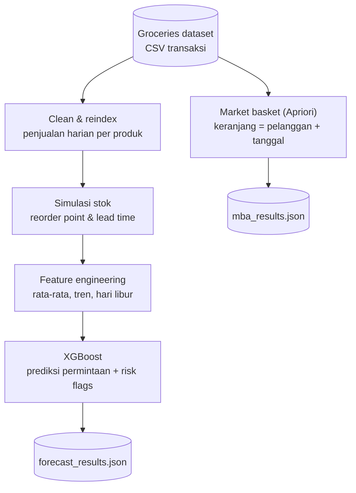
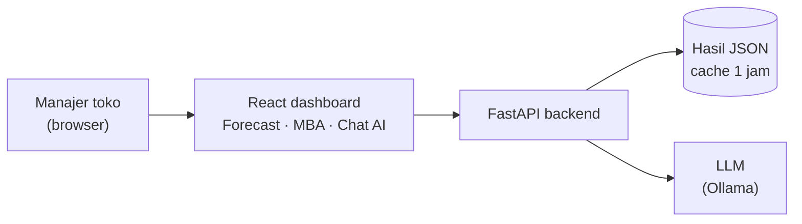

# Retail Inventory AI

Sistem analitik berbasis AI untuk membantu toko ritel mengelola stok. Sistem ini menjawab tiga pertanyaan yang sering dihadapi manajer toko:

| Pertanyaan manajer | Cara sistem menjawab |
|---|---|
| Produk mana yang hampir habis atau justru menumpuk? | **Prediksi permintaan (XGBoost)** + label risiko per produk |
| Produk apa yang sering dibeli bersamaan? | **Market Basket Analysis (Apriori)** |
| "Saya harus pesan apa hari ini?" | **Chat AI (LLM)** yang membaca kondisi stok terbaru |

Tujuannya: mengurangi **stok berlebih (overstock)** yang menahan modal dan mencegah **kehabisan stok (stockout)** yang membuat penjualan hilang.

> Proyek kelompok mata kuliah AI for Business, Institut Teknologi Bandung (2026).
> Repositori ini adalah fork dari [bastianns/AIforBusiness](https://github.com/bastianns/AIforBusiness). Lihat bagian [Tim](#-tim).

---

## 🧱 Teknologi

| Lapisan | Teknologi |
|---|---|
| Frontend | React 18, TypeScript, Vite, Recharts |
| Backend | FastAPI, Uvicorn |
| Machine learning | XGBoost (prediksi permintaan) |
| Market basket | Apriori & association rules (mlxtend) |
| LLM | Model `nemotron-3-super` lewat Ollama API |
| Data | pandas, NumPy, holidays |

Arsitektur backend memakai pola **Service–Layer–Repository**: `controllers` mengatur alur, `services` berisi logika bisnis, dan `repositories` menangani baca/tulis file.

---

## 🔄 Alur Kerja Sistem

Sistem punya dua alur: **pipeline offline**, yang mengolah data dan melatih model, dan **runtime**, yang berjalan saat dashboard dipakai.

### 1. Pipeline offline: dari data mentah ke hasil analisis



| Tahap | Yang dilakukan | Kode |
|---|---|---|
| **Clean & reindex** | Mengubah transaksi menjadi jumlah penjualan harian per produk. Hari tanpa penjualan diisi 0, sehingga setiap produk punya kalender harian yang lengkap. | `src/data_pipeline/pipeline.py` |
| **Simulasi stok** | Dataset tidak punya data stok, jadi stok disimulasikan: mulai dari 100 unit, pesan ulang 80 unit saat stok ≤ 20, barang datang 3 hari kemudian. Permintaan yang tidak terpenuhi dicatat sebagai *lost sales*. | `src/services/feature_service.py` |
| **Feature engineering** | Rata-rata penjualan 7 & 30 hari, tren 7 hari, *stock coverage* (stok cukup untuk berapa hari), hari dalam seminggu, akhir pekan, hari libur nasional. | `src/services/feature_service.py` |
| **XGBoost** | Memprediksi permintaan harian, lalu memberi label risiko ke setiap produk (lihat tabel di bawah). | `src/services/ml_service.py` |
| **Apriori** | Mencari pasangan produk yang sering dibeli bersama, beserta nilai *support*, *confidence*, dan *lift*. | `src/services/mba_service.py` |

Semua tahap dijalankan berurutan oleh `src/controllers/orchestrator.py`.

**Arti label risiko:**

| Label | Kapan muncul | Saran tindakan |
|---|---|---|
| `stockout_risk` | Stok hanya cukup untuk waktu lebih pendek dari waktu pengiriman | Segera pesan ulang |
| `overstock_risk` | Stok cukup untuk lebih dari 30 hari **dan** penjualan sedang turun | Tahan pemesanan |
| `deadstock_risk` | Stok cukup untuk lebih dari 30 hari **dan** hampir tidak terjual | Diskon atau cuci gudang |
| `promo_opportunity` | Penjualan turun tapi stok masih di atas 50 unit | Buat promo |
| `missed_revenue_flag` | Ada permintaan yang tidak terlayani karena stok sempat kosong | Tambah stok pengaman |

### 2. Runtime: saat dashboard dipakai



| Fitur di dashboard | Endpoint API | Yang terjadi |
|---|---|---|
| Tab **Forecast** | `GET /api/v1/forecast` | Menampilkan semua produk beserta prediksi, *coverage*, tren, dan label risiko |
| Tab **Market Basket** | `GET /api/v1/mba` | Menampilkan aturan "beli A → cenderung beli B" |
| Tombol **Refresh** di tab MBA | `POST /api/v1/mba/refresh` | Menjalankan ulang Apriori |
| **Chat AI** (tombol melayang) | `POST /api/v1/chat` | API menambahkan ringkasan stok (jumlah produk berisiko + 5 produk paling kritis) ke pertanyaan, lalu mengirimnya ke LLM |
| Refresh pipeline penuh | `POST /api/v1/forecast/refresh` | Menjalankan ulang pipeline data dan model XGBoost |

Dokumentasi interaktif semua endpoint tersedia di `http://127.0.0.1:8000/docs` saat backend berjalan.

---

## 🚀 Instalasi

### Prasyarat
- Python 3.10 atau lebih baru
- Node.js 18 atau lebih baru
- API key Ollama, untuk fitur chat AI

### Langkah 1: Clone dan install

```bash
git clone https://github.com/rivaldimhr/retail-inventory-ai.git
cd retail-inventory-ai

# Backend
python -m venv venv
source venv/bin/activate        # Windows: venv\Scripts\activate
pip install -r requirements.txt

# Frontend
npm install
```

### Langkah 2: Siapkan dataset
Dataset tidak disertakan di repositori. Unduh **Groceries Dataset** dari Kaggle (kolom: `Member_number`, `Date`, `itemDescription`), lalu simpan sebagai:

```
data/Groceries_dataset.csv
```

### Langkah 3: Atur API key LLM
Buat file `.env` di root proyek:

```env
OLLAMA_API_KEY=isi_api_key_kamu
OLLAMA_BASE_URL=https://alamat-server-ollama
```

Tanpa file ini, dashboard tetap berjalan normal. Hanya fitur chat AI yang tidak bisa menjawab.

### Langkah 4: Jalankan pipeline pertama kali

```bash
# Linux / macOS
PYTHONPATH=. python src/controllers/orchestrator.py

# Windows PowerShell
$env:PYTHONPATH = "."; python src/controllers/orchestrator.py
```

Perintah ini membuat `processed_features.csv`, `demand_model.pkl`, `forecast_results.json`, dan `mba_results.json` di folder `data/`.

### Langkah 5: Jalankan backend dan frontend
Buka dua terminal:

```bash
# Terminal 1: backend (http://127.0.0.1:8000)
PYTHONPATH=. uvicorn src.api.main:app --reload

# Terminal 2: frontend (http://localhost:5173)
npm run dev
```

Buka **http://localhost:5173** di browser.

---

## 🧑‍💼 Panduan Pengguna

Panduan ini untuk manajer toko atau staf gudang yang memakai dashboard.

### 1. Cek kondisi stok hari ini (tab Forecast)
1. Buka dashboard. Tab **Forecast** terbuka otomatis.
2. Lihat **kartu ringkasan** di bagian atas: jumlah produk yang dipantau, serta berapa yang berisiko stockout, overstock, dan deadstock.
3. Gulir ke **tabel produk**. Setiap baris menampilkan:
   - **Stok saat ini** dan **coverage**, yaitu stok cukup untuk berapa hari. Bar merah berarti hampir habis.
   - **Tren penjualan**: naik, stabil, atau turun.
   - **Label risiko** produk itu.
4. Pakai **kolom pencarian** untuk mencari produk tertentu, misalnya `whole milk`.
5. Klik **Refresh** untuk memuat data terbaru dari server.

### 2. Tentukan tindakan
| Kalau kamu melihat… | Lakukan |
|---|---|
| Label merah **Stockout** | Pesan ulang produk itu hari ini |
| Label **Overstock** | Tunda pemesanan berikutnya |
| Label **Deadstock** | Rencanakan diskon atau bundling |
| Label **Promo** | Pertimbangkan promosi untuk mendorong penjualan |

### 3. Cari ide bundling dan penataan rak (tab Market Basket)
1. Klik tab **Market Basket**.
2. Setiap baris berbunyi **"Jika membeli A → cenderung membeli B"**.
3. Baca tiga angkanya:
   - **Support**: seberapa sering kombinasi ini muncul dari seluruh transaksi.
   - **Confidence**: dari pembeli A, berapa persen yang juga membeli B.
   - **Lift**: di atas 1 berarti A dan B benar-benar saling terkait, bukan kebetulan. Makin tinggi makin kuat.
4. Pakai aturan dengan **lift tertinggi** untuk paket bundling, rak yang berdekatan, atau rekomendasi "sering dibeli bersama".
5. Klik **Refresh** di tab ini untuk menghitung ulang aturan dari data transaksi terbaru.

### 4. Tanya langsung ke Chat AI
1. Klik **tombol chat** di pojok kanan bawah.
2. Ketik pertanyaan dalam bahasa Indonesia atau Inggris. Contoh:
   - *"Produk apa yang harus saya pesan hari ini?"*
   - *"Kenapa stok whole milk berisiko?"*
   - *"Produk mana yang sebaiknya didiskon minggu ini?"*
3. AI menjawab dalam 2–4 kalimat berdasarkan data stok terbaru.

> AI hanya membaca ringkasan data dari sistem. Tetap cek ulang angkanya di tabel sebelum mengambil keputusan besar.

### 5. Perbarui data
Kalau ada data transaksi baru, ganti `data/Groceries_dataset.csv`, lalu jalankan ulang Langkah 4 di bagian Instalasi. Atau panggil `POST /api/v1/forecast/refresh` dan `POST /api/v1/mba/refresh` lewat halaman `/docs`.

Hasil forecast dianggap **usang setelah 24 jam**. Setelah itu API meminta pipeline dijalankan ulang.

---

## ⚠️ Keterbatasan

- **Stok masih simulasi.** Dataset hanya berisi transaksi, jadi stok, waktu pengiriman (3 hari), dan kategori ("General") memakai nilai yang sama untuk semua produk. Untuk dipakai di toko sungguhan, ganti dengan data stok asli.
- **Model belum dievaluasi** dengan pembagian data latih dan uji. Nilai `confidence_score` (0.85) masih placeholder.
- **Satu toko.** Semua data dianggap berasal dari toko `STR-001`.

---

## 📁 Struktur Proyek

```text
retail-inventory-ai/
├── data/               # Dataset mentah, model, dan hasil JSON (tidak di-commit)
├── notebooks/          # Validasi pipeline dan EDA
├── src/
│   ├── api/            # Server FastAPI
│   ├── config/         # Lokasi file data dan model
│   ├── controllers/    # Orchestrator alur kerja
│   ├── data_pipeline/  # Pembersihan dan reindex data
│   ├── dashboard/      # Frontend React (App.tsx, FloatingAIChat.tsx)
│   ├── llm_engine/     # Integrasi LLM dan prompt
│   ├── repositories/   # Baca/tulis file data, model, hasil
│   └── services/       # Logika bisnis: fitur, ML, market basket
├── index.html, package.json, vite.config.ts   # Konfigurasi frontend
└── requirements.txt    # Library Python
```

---

## 👥 Tim

Proyek kelompok lima orang:

- Bastian Natanael Sibarani
- Gabriel Marcellino
- Faishal
- Gymnastiar Anwar
- M. Rivaldi Mahari

Riwayat commit lengkap setiap anggota tersimpan di repositori ini.
